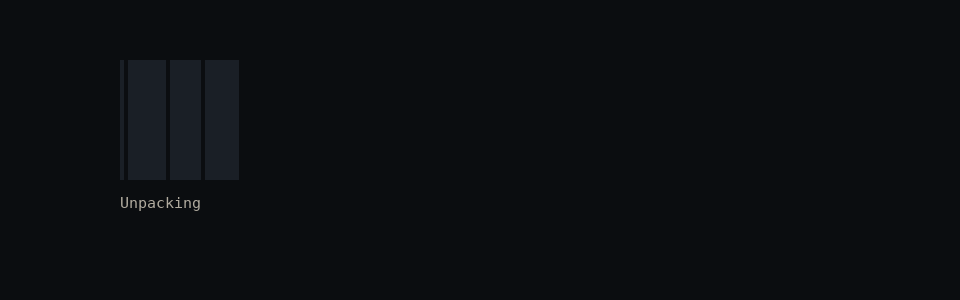
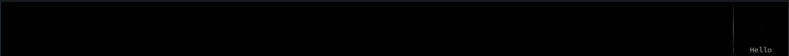
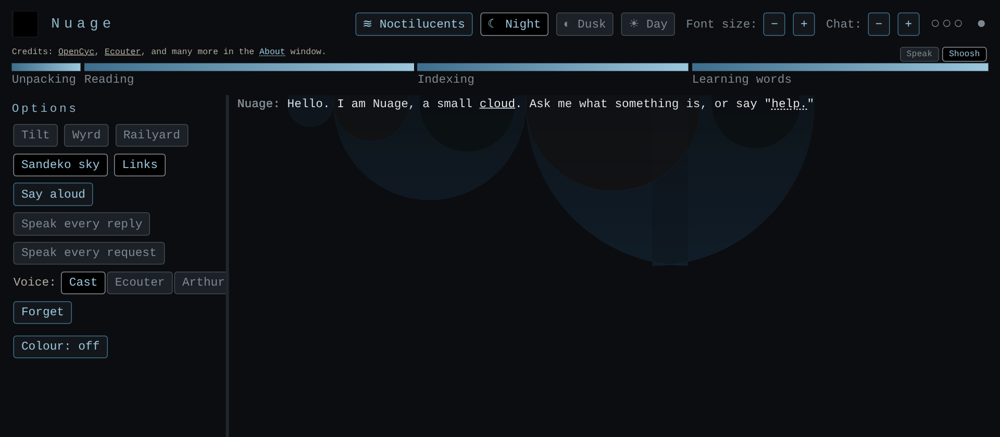
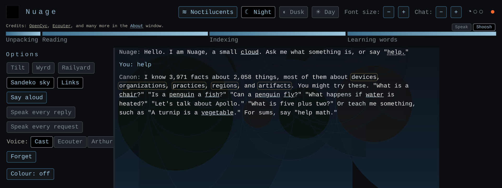
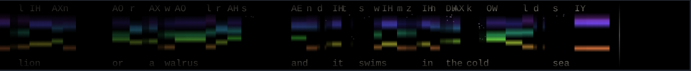
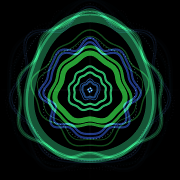
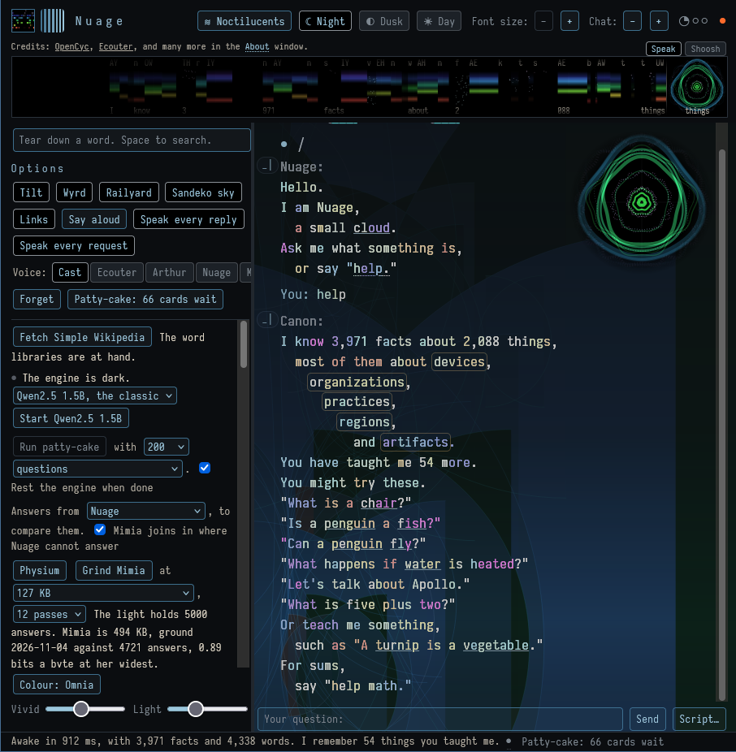

# Nuage

**A small talking cloud: a classic chat engine with no model inside, in one page, offline, in four cuts.** Open one and she
wakes; nothing leaves the page.

## **[Click here to get on board →](https://silberpunkt.github.io/nuage/)**

*Her page, with the four cuts to open in your browser: each one file, nothing to install, nothing sent anywhere. Save any cut and it works from your disk. The picture above is the same door.*

---

## What she does

Nuage answers "What is a kettle?" from a pocket of Cyc stripped to bytes and bone, learns what you teach her in plain
sentences and keeps it in your browser, speaks in Ecouter's voice (and her own), draws the sound of what she says, and
shows the shape of every sentence as circles.

**What to say to her.** "What is a kettle?" "Is a penguin a fish?" "Can a penguin fly?" "What happens if water is heated?"
Or tell her: "A turnip is a vegetable." "Things are not alive." "A dish holds food in a bowl." She keeps what you tell her,
in your words, and gives it back on waking. "Draw the sound of glimmer." (the 256 and up). "Say aloud" reads any line in
Ecouter's voice, or hers. "Help." "Notes." "What have I taught you?" "What have we talked about?"

**Tilt** airs a reply out at every stop and comma, then tilts the joints inside. **Sandeko** draws a circle about every
sentence and every clause, over the whole talk and the line you are typing. **Colour** sets each letter in the colour of its
pitch. The voice has a **strip**, a **square**, and a **wall**.

## The four cuts

| cut | size | holds |
|---|---|---|
| [`nuage-64k.html`](https://silberpunkt.github.io/nuage/dist/cuts/nuage-64k.html) | 95.4 KB | Nuage alone: her cards, the pictures, and a slice of Cyc. No voice, no tilt. |
| [`nuage-128k.html`](https://silberpunkt.github.io/nuage/dist/cuts/nuage-128k.html) | 174.2 KB | Nuage as she stands: every card, Cyc, the shelves, Ecouter's voice and the wall it draws, Wallbreaker. |
| [`nuage-256k.html`](https://silberpunkt.github.io/nuage/dist/cuts/nuage-256k.html) | 255.8 KB | The pocket instrument: the 128, the sound drawings in the talk, Aquavit and its viewer, and Mimia's core. |
| [`nuage-1024k.html`](https://silberpunkt.github.io/nuage/dist/cuts/nuage-1024k.html) | 883.3 KB | The 256 with the whole of Mimia. |

Each is one file in `dist/cuts/`. `dist/nuage.html` is the workshop's own build, with everything the panel needs. The sizes
are aims, not oaths; `dist/cuts/MANIFEST.txt` says what each holds and what it left out.

*The workshop at User1's own settings. The Patty-cake panel at the left is the workshop's; the rest is in every cut.*

## What is in her

- **The engine** (`src/nuage.js`): a LISP reader, Cyc's forms (genls, isa, comment, prop, has, why, vext, picture),
  microtheories, defaults and rules, Do What I Mean, a small calculator, and the old tricks. She writes in the manner of
  Strunk and White. When you tell her something she keeps it as a kind, a quality, a meaning, or a thing said, and gives it
  back on waking.
- **The voices** (`src/ui.js`, VOICE_SRC): all are operations on Ecouter's frames. Nuage takes the yinyang arc across each
  sentence, slower then faster, lower then higher, lifted, and lands; Miria is that, nearly too much; Arthur is the slight
  inverse, out of respect; Blando is the human as a jest, voiced as a computer. A cast gives each line to the right voice.
  See [docs/voices.md](docs/voices.md).
- **The drawings**: the strip (colour is pitch, brightness is strength, sparks are hiss, time runs left, with the phones
  above and the words below), the square (the spectrogram box-reduced to nine bands, which remembers the first sound and
  the last), and the fleuriant (the wall the voice strikes, rings born at the centre and spreading, the past the outer ring).
  The gallery of words drawn this way is [the Noctilucents](https://silberpunkt.github.io/nuage/words/gallery.html).
- **Sandeko**: the enclosure diagram, a circle proper about each sentence and each clause, composed by difference so the
  overlaps go to black, in a tray of grey lines or a sky of depths, over the whole talk and the line being typed.
- **Mimia** (`patty/mimia`): a mirror, a byte-level net with balanced-ternary weights, five trits a byte, ground from the
  light of a local model's answers with commerce kept out; any prefix of her file is a smaller Mimia. Her lines are her own
  words, scanned into sentences by a table grated from Simple English Wikipedia; a click shows them reconnected.
- **The teardown** (`words/`): a word's sounds by rule, its mouth, its felt sense, its parts, its story, its kin by
  descent and by sound, and what it means, with the word libraries fetched to the machine when asked.
- **The janitor** (`patty/`): a PHP page and a panel that run the engines, gather the light, and rule on the cards.

A LISP reader and Cyc's forms, Ecouter's formant synthesizer in one file, Wallbreaker's tilt, the rings of Vespers, and a
punctuation table grated from Simple English Wikipedia. No samples, no network, no model.

## Running her

Open any cut in a browser ([the 64](https://silberpunkt.github.io/nuage/dist/cuts/nuage-64k.html), [the 128](https://silberpunkt.github.io/nuage/dist/cuts/nuage-128k.html), [the 256](https://silberpunkt.github.io/nuage/dist/cuts/nuage-256k.html), [the 1024](https://silberpunkt.github.io/nuage/dist/cuts/nuage-1024k.html), or [her page](https://silberpunkt.github.io/nuage/) that holds them); nothing else is needed. For the workshop: `node pack/pack.js` packs `dist/nuage.html`,
`node pack/cuts.js` builds the four cuts, `qjs test/score.mjs .` runs the scoreboard (QuickJS), and
`qjs test/replay.mjs . test/report4.txt` replays a user's session line by line. `node pack/repo.make.js` stages this
repository from the workshop.

## Who made her

User1 and Claude, after the grace of the old chat programs, with [Ecouter](https://github.com/silberpunkt/ecouter),
Wallbreaker and [Vespers](https://github.com/silberpunkt/vespers) from the same house. MIT. See [ATTRIBUTION.md](ATTRIBUTION.md)
for everything she stands on, and [docs/workshop.md](docs/workshop.md) for the plan she grew by.
